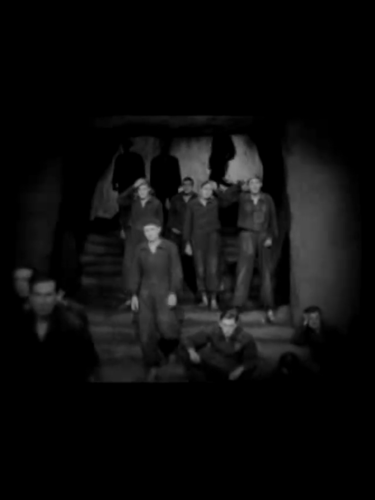
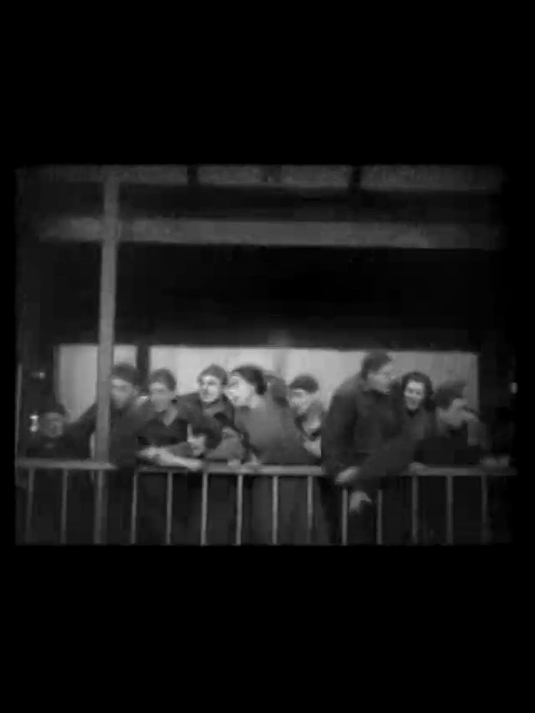

# Very Slow Movie Player for Kindle

Play an entire film over **days** on a jailbroken Kindle's E-Ink screen — one still
frame at a time. Inspired by [Bryan Boyer's](https://debugger.medium.com/this-film-does-not-exist-26f9c4c2bb16)
and [Tom White's](https://tom-e-white.com/2024/06/very-slow-movie-player.html) very
slow movie players. A 2-hour movie becomes a 9-day piece of ambient cinema.

<table>
<tr>
<td align="center" width="34%"><br><sub>first frame (≈ 00:15:00)</sub></td>
<td align="center" width="33%"><br><sub>the shift change</sub></td>
<td align="center" width="33%"><br><sub>the crowd</sub></td>
</tr>
</table>

<sub>Grayscale stills from <i>Metropolis</i> (1927), letterboxed to the Kindle screen and spread across a 9-day run.</sub>

## What it does
- Shows **one still frame** from a movie, advancing slowly so the whole film plays
  over a configurable span (default **9 days**).
- Grayscale, letterboxed to the Kindle screen, original aspect ratio preserved.
- The frame is chosen from **elapsed real time**, so it self-corrects across sleeps,
  reboots, and missed ticks — and progress survives a reboot.
- Simple controls: start / pause / resume / stop / restart / status / change pace /
  load another movie.
- Runs **standalone on the Kindle** (plugged in). Your Mac is only used once, to
  pre-process the movie.

## How it works
There is **no video on the Kindle**. On your Mac, FFmpeg slices the movie into N
evenly-spaced grayscale PNGs (N = days × 1440 / interval). Only those images are
shipped. On the Kindle, a tiny shell loop figures out *which* still to show right now
and paints it with the native **`eips`** e-ink tool:

```
MAC (once):   movie.mp4 ──FFmpeg──► frames/frame_00001.png … (letterboxed, gray)
                                        │ scp
KINDLE:       frames/  +  state/playback.env  +  vsmp-worker.sh loop ──► eips ──► screen
```

The whole engine is one line: `frame_index = floor(elapsed_time / duration × total_frames)`.

- **`bin/vsmp.sh`** — control surface (start/pause/resume/stop/status/set-duration/load).
  Writes the state file; never draws.
- **`bin/vsmp-worker.sh`** — the render loop. Every 60s: compute the frame from the
  clock; on a change do a clean `eips` full update, otherwise quietly re-assert the
  current frame so it survives screen clears.
- **`bin/display-mode.sh`** — switch which app owns the screen (this player vs. a
  weather dashboard, etc.), guaranteeing only one draws at a time.
- **`tools/extract-frames.sh`** — Mac: FFmpeg inspect + extract (supports a start
  offset, e.g. skip the first 15 min).
- **`tools/deploy.sh`** — Mac: push scripts + frames to the Kindle.
- **`scriptlets/`** — optional Kindle "library" launchers (tap to switch modes).

## Requirements
- A **jailbroken** Kindle (developed on Paperwhite 11th gen / PW5). The native
  **`eips`** tool is used for image display (no extra install needed).
- **FFmpeg** on your Mac/PC (`brew install ffmpeg`) for pre-processing.
- SSH access to the Kindle over Wi-Fi.
- A **DRM-free** video file. For testing, a public-domain film works great
  (e.g. *Metropolis (1927)* or *Night of the Living Dead (1968)* from archive.org).

## Setup
```sh
# 1. extract frames on the Mac  (movie, output dir, frame count, [start seconds])
#    9 days @ 2-min interval = 6480 frames
./tools/extract-frames.sh movie.mp4 frames 6480            # whole film
./tools/extract-frames.sh movie.mp4 frames 6480 900        # ...skipping first 15 min

# 2. deploy scripts + frames to the Kindle
export KINDLE_HOST=root@<your-kindle-ip>
./tools/deploy.sh frames

# 3. start playback (on the Kindle, over SSH)
/mnt/us/vsmp/bin/vsmp.sh start 9
```

## Controls (on the Kindle)
```sh
vsmp.sh start [days]     # begin from the top
vsmp.sh pause            # freeze on the current frame
vsmp.sh resume           # continue
vsmp.sh stop             # stop (and hand the screen to another app, if configured)
vsmp.sh restart          # from frame 1
vsmp.sh status           # progress, current frame, time remaining
vsmp.sh set-duration D    # re-pace to D days, keeping the current frame (no jump)
vsmp.sh load NAME [days]  # switch to another deployed frame set
```

## Configuration (`config.sh`)
`PLAYBACK_DAYS`, `INTERVAL_MIN`, screen size, and all on-device paths. Changing the
duration live reschedules pacing without re-extracting frames.

## Storage & performance
~6,480 frames ≈ **1–2 GB** depending on the film (grayscale PNGs ~200–300 KB each).
`eips` does a full update only when the frame changes, so the screen is static (and
free, on E-Ink) between changes.

## Notes & limitations
- **Power:** "always on" works by keeping the device awake — use a **wall charger**,
  not a computer (a computer puts the Kindle in USB drive mode: screen blanks, Wi-Fi
  off). For multi-week battery you'd need RTC deep-sleep wake (not implemented here).
- **Dark mode:** frames are drawn with `eips -N 0` (day mode) so they look right
  regardless of the device's dark-mode setting.
- **Orientation:** frames are baked portrait; for landscape, re-extract with the
  screen dimensions swapped.
- Keep it **separate** from other screen apps; use `display-mode.sh` to switch so two
  things never draw at once.

## Credits & inspiration
- Inspired by the very slow movie players of
  [Bryan Boyer](https://debugger.medium.com/this-film-does-not-exist-26f9c4c2bb16) and
  [Tom White](https://tom-e-white.com/2024/06/very-slow-movie-player.html).
- **E-Ink image display:** the Kindle's native `eips`.
- **Preprocessing:** [FFmpeg](https://ffmpeg.org).
- **Test film:** *Metropolis* (1927), public domain, via the
  [Internet Archive](https://archive.org/details/Metropolis1927EnglishVersion).
- **Jailbreak & tooling:** the [KindleModding](https://kindlemodding.org) community.
- Developed with **Claude Code**.

## License
MIT — see [LICENSE](LICENSE). You are responsible for using only DRM-free video you
have the right to use. Not affiliated with Amazon.
